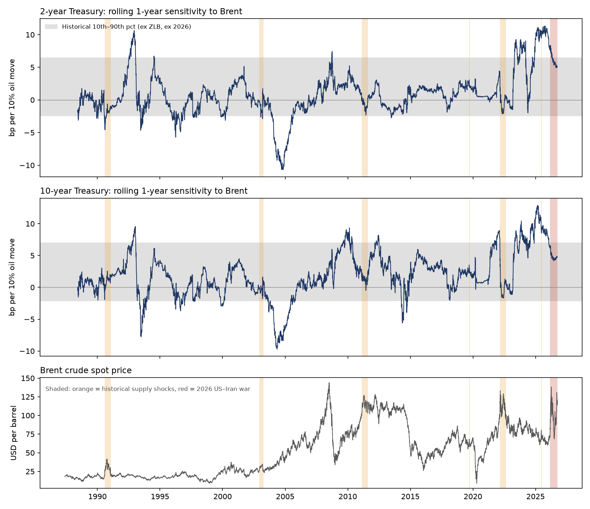

# Are Treasuries Overreacting to the 2026 Oil Shock?

**Oil Supply Shocks and Treasury Yield Sensitivity: Evidence from the 2026 US–Iran War**

[](https://github.com/kevinkan2004-crypto/oil-shock-treasury-repricing/actions/workflows/update_data.yml)

During the 2026 oil shock, do Treasury yields react more to oil than they did in past supply shocks? If so, does the excess come from policy expectations (the short end) or from the term premium (the long end)?

<!-- ASOF:START -->
*Results as of Sep 29, 2026. Data refresh daily; see [`results/`](results/) for the latest numbers.*
<!-- ASOF:END -->

## TL;DR

- **Against past supply shocks, the 2y is about four times as sensitive to oil in 2026.** A 10% Brent move now moves the 2y by 6.5 bp, against 1.1 bp in six historical supply shocks (excess +5.4 bp, p < 0.01).
- **The excess runs through Fed expectations, not the term premium.** In the ACM decomposition of the 10y, the expected policy path carries the excess (+4.4 bp, p < 0.01). The term premium does not.
- **But that sensitivity predates the war.** It rose after the 2022 hiking cycle began. A structural break test dates the shift to mid-2024, before any shots were fired.
- **Against the post-2022 norm, 2026 shows no overreaction.** No series shows a significant excess at the 5% level. For the 2y this holds in every robustness check: daily and weekly data, with or without FOMC and CPI days, and under alternative regime dates.
- **The one signal to watch: the 10y term premium since the war resumed in July.** It has started to respond more to oil, but the result is not yet robust, and its sensitivity is still no higher than in past supply shocks.



*The rolling oil beta was already near the top of its historical range in 2023–25, using only pre-war data.*

## Motivation

In spring 2026, as Brent rose 94% from its pre-war level, market commentary argued that bond traders were paying too much attention to oil. This project tests that claim. It compares the 2026 oil–yield link with past supply shocks and with the recent post-2022 regime, and splits the 10y yield to see which part of the curve is reacting.

## Data

| Series | Source | Use |
|---|---|---|
| 2y and 10y Treasury yields (DGS2, DGS10) | FRED | Dependent variables, daily change in bp |
| Brent crude (DCOILBRENTEU) | FRED (EIA) | Main regressor, log return × 100 |
| NASDAQ Composite (NASDAQCOM) | FRED | Growth control: separates demand- from supply-driven oil moves |
| 10y ACM yield, risk-neutral yield, term premium | NY Fed (Adrian, Crump and Moench) | Decomposition into policy expectations and term premium |
| CPI release dates | ALFRED (CPIAUCNS vintages) | Robustness: excluding macro-news days |
| FOMC statement dates | Hand-compiled from Fed calendars | Robustness: excluding macro-news days |

Daily data from May 1987. A GitHub Actions workflow fetches new data every day, reruns every script and commits the updated results.

Two data issues are handled explicitly. Brent closes in London and Treasuries in New York, so the regressions include the next-day oil return and sum the two betas (Dimson correction). Holidays differ across the two markets, so only days with both yield and oil data are kept, and changes are computed across the nearest valid trading days.

## Methodology

### Episodes

Six historical supply shocks serve as the benchmark. Selection criteria were set before seeing results: a clear exogenous trigger, an actual or credibly threatened supply disruption, and no dominant concurrent macro event.

Start dates come from cited news sources. End dates come from a price-reversion rule. An episode ends on the first day the 5-day average of Brent falls back to its pre-trigger level, capped at 126 trading days. Events that produced no price shock are dropped (e.g. Hurricanes Katrina and Rita in 2005).

| Episode | Period | Brent peak vs. baseline |
|---|---|---|
| Iraq invades Kuwait / Gulf War | Aug 1990 – Jan 1991 | +108% |
| Venezuela strike and Iraq invasion | Dec 2002 – Apr 2003 | +36% |
| Libyan civil war* | Feb – Aug 2011 | +23% |
| Abqaiq attack | Sep – Oct 2019 | +12% |
| Russia invades Ukraine | Feb – Aug 2022 | +34% |
| Israel–Iran Twelve-Day War | Jun 2025 | +13% |
| **US–Iran war (study sample)** | **Mar 2, 2026 – present** | **+94%** |

\*Excluded from the 2y benchmark because it falls inside the zero lower bound.

### Main regression

For each maturity *n*, a full-sample regression with period dummies and oil interactions:

$$
\Delta y^{(n)}_t = \alpha + \sum_k \delta_k D^k_t + \sum_k \left(\beta_{ka}\,\Delta Oil_t + \beta_{kb}\,\Delta Oil_{t+1}\right) D^k_t + \beta_{0a}\,\Delta Oil_t + \beta_{0b}\,\Delta Oil_{t+1} + \gamma\,\Delta Eq_t + \varepsilon_t
$$

where *k* ∈ {2026, historical shocks, ZLB}. The test is one-sided: is the 2026 total beta (same day + next day) larger than the historical-shock total beta? OLS with Newey-West standard errors (10 lags). All betas are reported in **bp per 10% Brent move**.

### Decomposition

The same regression is run on the NY Fed ACM 10y risk-neutral yield (expected policy path) and term premium. The two components add up to the ACM fitted yield, so the component betas add up to the total.

### Regime control

To test whether 2026 is an overreaction or a new normal, a post-regime dummy and its oil interactions are added, so recent normal times get their own sensitivity. The regime starts on **Mar 17, 2022**, the day after the Fed's first hike ended the zero lower bound. The date is set by economics rather than estimated: choosing the date that maximizes the pre/post gap would raise the post-regime baseline and tilt the result toward "no overreaction".

### Break test

A sup-Wald test (Andrews, 1993) on the pre-war sample (Jan 2016 – Feb 27, 2026) tests whether, and when, oil sensitivity rose before the war. Every date in the middle 70% is tried as a break; for each, the post-break oil interactions are Wald-tested with Newey-West covariance, and the largest statistic gives the break date. Because the maximum is taken over many dates, the usual χ² critical values do not apply; critical values come from simulating the limiting distribution (20,000 draws): 9.8 at 10%, 11.6 at 5%, 15.2 at 1%.

The break date is supporting evidence, not the regime boundary. The regime start marks when the oil-to-policy channel opened; the break marks when sensitivity actually stepped up within it.

## Results

<!-- RESULTS:START (this section can be regenerated from results/*.csv) -->

### 1. 2026 vs. past supply shocks

| Maturity | Normal | Past shocks | 2026 | 2026 excess | 95% CI | p (one-sided) |
|---|---|---|---|---|---|---|
| 2y | 1.5 | 1.1 | 6.5 | **+5.4** | [2.8, 7.9] | < 0.01 |
| 10y | 2.0 | 4.1 | 6.2 | +2.1 | [−1.3, 5.5] | 0.11 |
| 10y − 2y slope | 0.6 | 2.9 | −0.3 | −3.2 | [−5.5, −0.8] | — |

Against past supply shocks, the 2y reacts significantly more in 2026; the 10y does not. Oil moves now flatten the curve. Weekly data give the same pattern (2y excess +7.3, p < 0.01; 10y +4.4, p 0.08).

### 2. Where the excess comes from (10y ACM decomposition)

| Component | Normal | Past shocks | 2026 | 2026 excess | 95% CI | p (one-sided) |
|---|---|---|---|---|---|---|
| Policy expectations | 0.7 | −0.8 | 3.5 | **+4.4** | [2.9, 5.8] | < 0.01 |
| Term premium | 1.3 | 5.5 | 2.8 | −2.7 | [−6.2, 0.8] | 0.94 |
| Total | 2.0 | 4.6 | 6.3 | +1.7 | [−2.0, 5.3] | 0.18 |

The excess runs through the expected policy path, not the term premium: markets read oil as a signal about the future Fed path. The 10y total looks insignificant only because the two components offset. Because ACM decomposes nominal yields, the policy-expectations component mixes expected real rates and expected inflation; it cannot say which of the two is moving.

### 3. Overreaction or new normal?

| Series | Pre-2022 normal | Post-2022 normal | 2026 | 2026 vs. post-2022 normal (daily) | p | Same, weekly | p |
|---|---|---|---|---|---|---|---|
| 2y | 1.1 | 4.7 | 6.5 | +1.8 [−2.4, 6.0] | 0.20 | +1.6 | 0.33 |
| 10y | 1.8 | 4.6 | 6.2 | +1.6 [−2.0, 5.2] | 0.19 | +0.8 | 0.38 |
| 10y policy expectations | 0.6 | 1.7 | 3.5 | +1.9 [−0.8, 4.5] | 0.08 | +2.0 | 0.16 |
| 10y term premium | 1.0 | 3.4 | 2.8 | −0.6 [−3.8, 2.5] | 0.66 | −1.8 | 0.78 |

Since 2022 the 2y's oil sensitivity has run at about 4.2 times its earlier level. Against that norm, no series shows a significant 2026 excess at the 5% level.

**Break test (pre-war sample).**

| | 2y | 10y | 10y policy expectations |
|---|---|---|---|
| Break date | May 1, 2024 | Apr 11, 2018 | Jul 26, 2024 |
| sup-Wald (p) | 13.7 (0.02) | 10.7 (0.07) | 16.3 (0.006) |
| Shift after break (bp/10%) | +6.8 | +3.9 | +4.5 |

The 2y and the 10y policy expectations both break in mid-2024, before the war; the 10y yield's only candidate break is in 2018 and significant only at 10%. Read with the rolling betas, sensitivity began rising in 2023 and settled into a higher regime by mid-2024. Because the Mar 2022 baseline still includes the low-sensitivity days of 2022–23, the main comparison is conservative. Using the break date as the regime boundary instead puts 2026 below the post-break norm (2y −2.9 [−6.3, 0.5]), but that comparison is biased toward "no overreaction", so it is not the main setting.

<!-- RESULTS:END -->

## Robustness

<!-- ROBUSTNESS:START (regenerated from results/*.csv) -->

2026 vs. the post-2022 normal, bp per 10% Brent move (one-sided p in parentheses):

| Check | What it addresses | 2y | 10y | 10y policy exp. |
|---|---|---|---|---|
| Baseline (daily) | — | +1.8 (0.20) | +1.6 (0.19) | +1.9 (0.08) |
| Weekly data | London/New York close mismatch | +1.6 (0.33) | +0.8 (0.38) | +2.0 (0.16) |
| Excl. FOMC + CPI days | Macro news inflating the new normal | +0.8 (0.36) | +0.7 (0.36) | +1.3 (0.19) |
| Regime from Jul 1, 2021 | Earlier start of the inflation regime | +2.4 (0.10) | +2.9 (0.06) | +2.0 (0.04) |
| Regime from Jul 27, 2023 | Start after the last hike | −0.3 (0.57) | −1.2 (0.75) | +0.5 (0.30) |
| 2026 Phase 1 (Mar 2 – Jul 1) | Excess hidden by averaging | +1.5 (0.26) | +0.4 (0.43) | +2.0 (0.07) |
| 2026 Phase 2 (Jul 8 – now) | Current market | +2.4 (0.15) | +3.7 (0.03) | +1.7 (0.15) |

<!-- ROBUSTNESS:END -->

**What holds.** Against past shocks, the 2y excess is significant in every version (+7.3 weekly, +5.4 excluding FOMC and CPI days, +5.0 and +6.0 in the two phases). Against the recent norm, no version shows a significant 2y excess. Excluding FOMC and CPI days raises the post-2022 normal rather than lowering it, so macro-news days were not inflating the baseline.

**What is fragile.** The 10y and its policy-expectations component depend on the regime start date. With the earliest start, the policy-expectations excess reaches p 0.04; with later starts it disappears.

**The signal to watch.** Since the war resumed on Jul 8, the 10y's daily oil sensitivity rose from 5.0 to 8.3 bp (difference p 0.02), entirely through the term premium (1.5 to 4.9 bp, p 0.01). It is not yet robust: weekly data show no such rise, Phase 2 has only 58 trading days, and this check runs many comparisons. Even in Phase 2, the term premium's oil sensitivity is no higher than in past supply shocks (−0.6 bp, 95% CI [−4.4, 3.2]).

## Interpretation and trade implications

The bond market is not overreacting to oil. It is reacting at the sensitivity it already had before the war. That sensitivity rose with the post-2022 inflation regime and settled by mid-2024, mostly through the expected policy path. The term premium did not rise with it, so markets have not demanded extra compensation for inflation risk, consistent with confidence that the Fed will contain the pass-through from energy prices.

A working hypothesis for why (not tested): while the Fed was hiking, it set the rate path. Once the cycle ended, markets debated when and how much it would cut, and every oil move shifted that debate.

| Finding | Implication |
|---|---|
| No excess against the recent norm | No mean-reversion trade on oil-driven yield moves |
| Sensitivity is high and stable | Use the betas as a scenario tool: a 10% Brent move maps to about 6–7 bp on the 2y and 6 bp on the 10y |
| Oil moves flatten the curve | Oil spikes favor 2s10s flatteners; oil relief favors steepeners |
| Phase 2 term-premium signal, if it persists | First sign that the long end is pricing oil risk beyond the policy channel; would argue for long 10y or a flattener |

**What would invalidate this view:** a prolonged closure of the Strait of Hormuz, or 5y5y inflation breakevens starting to rise, which would signal that oil is feeding into long-run inflation expectations rather than just the near-term Fed path.

## Limitations and next steps

- **No evidence of overreaction is not proof of none.** Upper confidence bounds of about 5–6 bp leave room for a moderate excess.
- Episode-level results rest on few observations: the benchmark has six episodes, Phase 2 has 58 trading days, and two historical episodes last under 15.
- The term premium is not observed; it is the residual of the ACM model, and other term structure models may split the response differently.
- The regime start date is a judgment call, and the 10y results depend on it.
- The estimated break dates sit near the end of the admissible search window (Aug 13, 2024), so the true shift may be later than estimated, though still before the war.
- Not yet done: WTI instead of Brent, dropping the NASDAQ control, asymmetric betas for oil rises vs. falls, fixed 60/120-day episode windows, episodes from the Känzig (2021) oil supply news shock series, a Bai-Perron multiple-break test, and a TIPS decomposition (real yields and breakevens) to separate the Fed's expected real-rate response from inflation expectations.

## Repository structure

```
oil-shock-treasury-repricing/
├── .github/workflows/update_data.yml   # daily fetch, rerun, commit
├── data/
│   ├── oil_bond_data.xlsx              # FRED + ACM series
│   ├── cpi_release_dates.csv           # from ALFRED
│   └── fomc_dates.csv                  # hand-compiled
├── src/
│   ├── fetch_data.py                   # download FRED, ACM, CPI dates
│   ├── prepare.py                      # returns, episode windows, dummies
│   ├── descriptive.py                  # statistics by period, episode moves
│   ├── regressions.py                  # main regressions, decomposition, regime control, break test
│   ├── robustness.py                   # weekly, FOMC/CPI exclusion, phases, alt. regimes
│   └── figures.py                      # charts
├── results/                            # CSV outputs
├── figures/                            # PNG charts
└── docs/research_outline.md            # full methodology and notes
```

## Reproduce

```bash
git clone https://github.com/kevinkan2004-crypto/oil-shock-treasury-repricing.git
cd oil-shock-treasury-repricing
pip install -r requirements.txt

python src/fetch_data.py
python src/prepare.py
python src/descriptive.py
python src/regressions.py
python src/robustness.py
python src/figures.py
```

## References

- Adrian, T., Crump, R. K. and Moench, E. (2013). Pricing the term structure with linear regressions. *Journal of Financial Economics*, 110(1), 110–138.
- Andrews, D. W. K. (1993). Tests for parameter instability and structural change with unknown change point. *Econometrica*, 61(4), 821–856.
- Bai, J. and Perron, P. (1998). Estimating and testing linear models with multiple structural changes. *Econometrica*, 66(1), 47–78.
- Dimson, E. (1979). Risk measurement when shares are subject to infrequent trading. *Journal of Financial Economics*, 7(2), 197–226.
- Känzig, D. R. (2021). The macroeconomic effects of oil supply news: Evidence from OPEC announcements. *American Economic Review*, 111(4), 1092–1125.
- Newey, W. K. and West, K. D. (1987). A simple, positive semi-definite, heteroskedasticity and autocorrelation consistent covariance matrix. *Econometrica*, 55(3), 703–708.

## Author

**Kevin (You-Siang) Kan**, MS in Financial Economics, Columbia Business School
[LinkedIn](https://www.linkedin.com/in/yousiang) · kevinkan2004@gmail.com

*This project is for research and educational purposes only and is not investment advice.*
